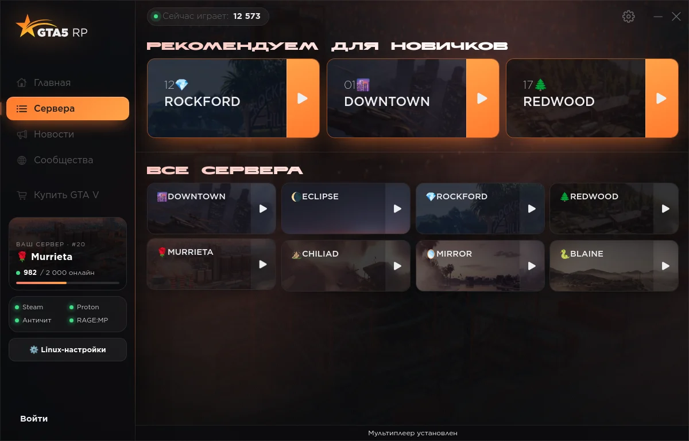
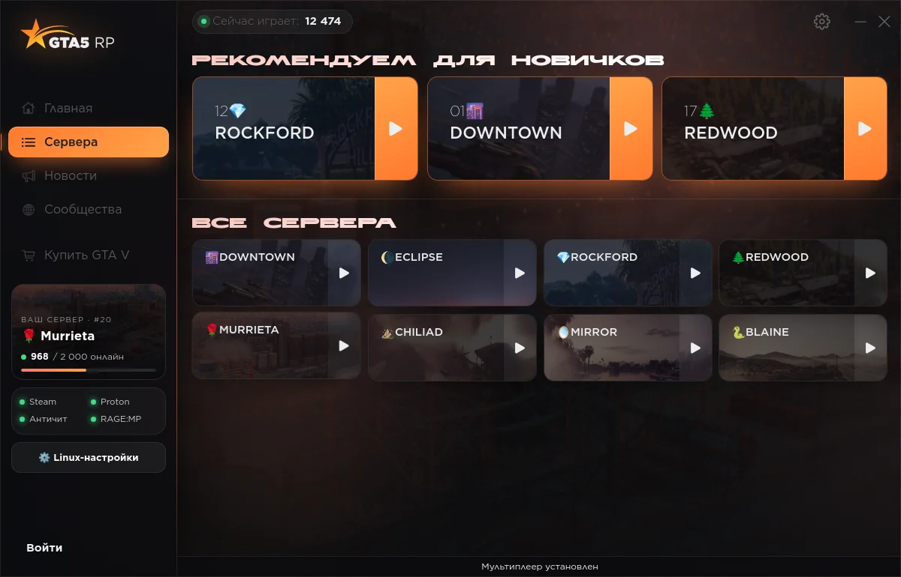
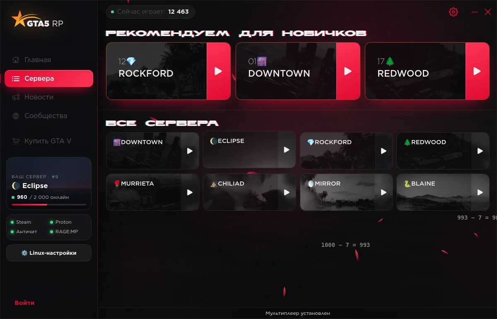
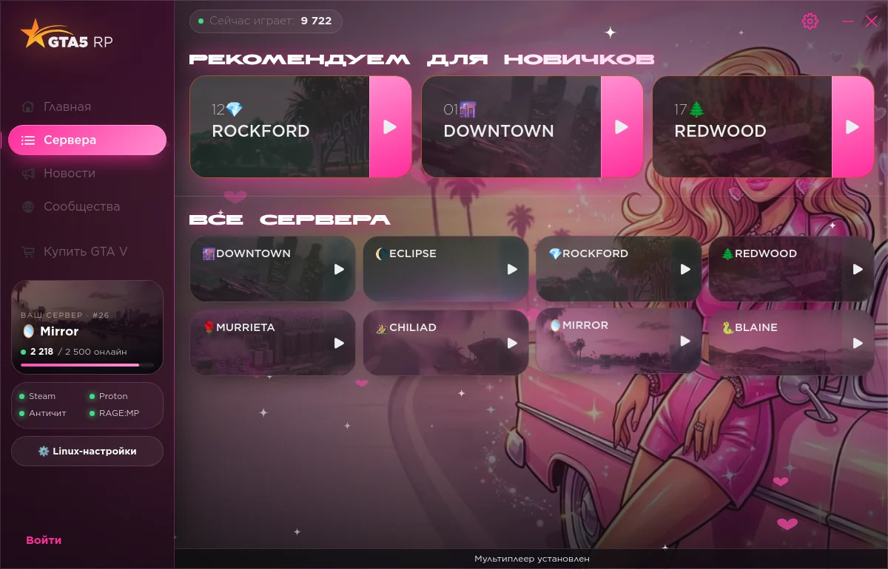
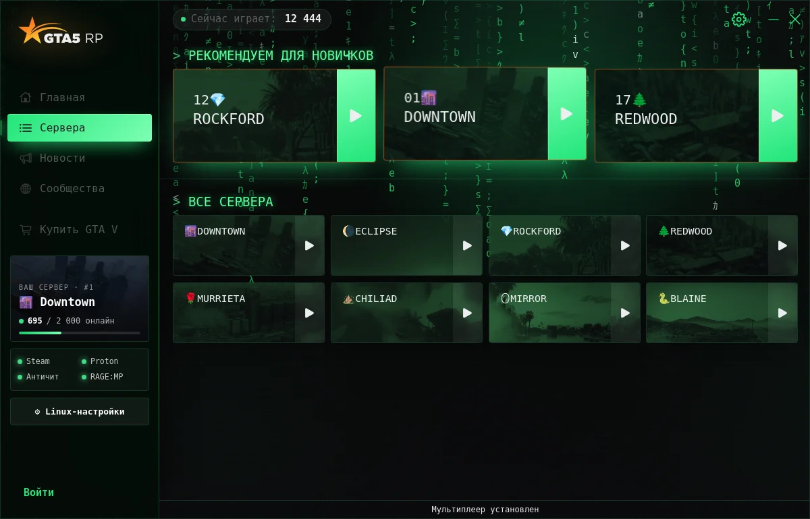
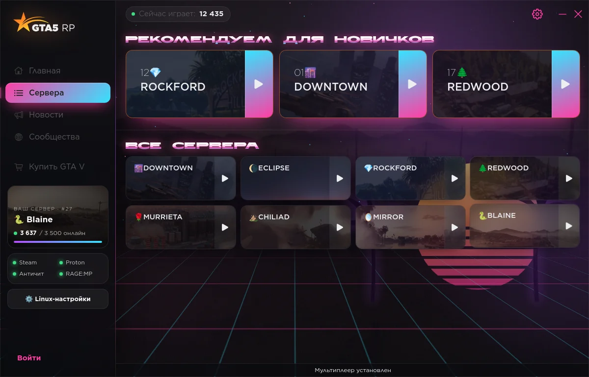
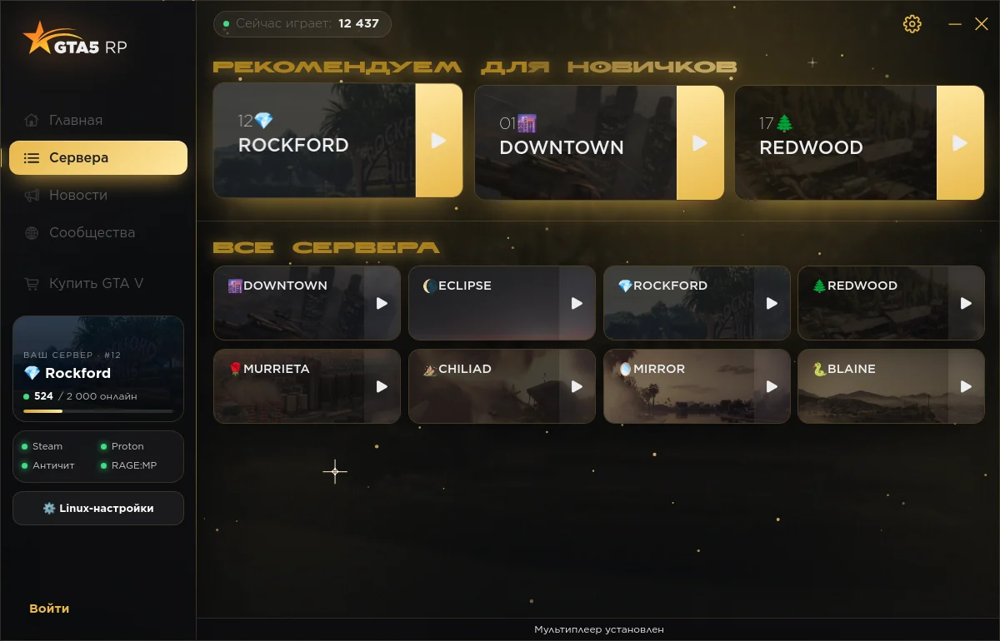

# GTA5RP Launcher for Linux

[Русский](README.md) · **English** · [Website](https://alinaz18.github.io/gta5rp-launcher-linux/)

An unofficial [GTA5RP](https://gta5rp.com) launcher for **Linux and Windows**. It shows the
original interface from the official 5RP installer with a new look and six animated themes,
and replaces the protected Windows core with its own Python core. On Linux RAGE:MP and GTA V
start through Steam's Proton, on Windows directly.



| Original | zxc · dead inside | Barbie |
|---|---|---|
|  |  |  |
| **Vibe coder** | **Vice City** | **Diamond Casino** |
|  |  |  |

## Features

- **Original 5RP interface** — login, servers, news, profile, captcha and 2FA work as in
  the official launcher.
- **Live server-themed background** — the selected server's art fills the window with
  matching aurora glows and a cursor light; hovering another server smoothly morphs into
  its theme.
- **New look** — glass sidebar, cards with 3D tilt and shine, staggered animations; can be
  toned down or turned off for slower PCs.
- **Sidebar widgets** — "Your server" card with live online count and Steam / Proton /
  anti-cheat / RAGE:MP indicators.
- **Linux settings** — Proton choice, GTA V folder, minimize on play, verbose Proton log,
  system check, EasyAntiCheat Runtime install, force-close the game.
- **Six animated themes**, switchable in settings.
- **Windows version** with the same interface, background and themes; RAGE:MP starts directly.
- **The official installer downloads itself** if it isn't in your Downloads folder.
- **Plain Qt interface** as a Linux fallback (`gta5rp-launcher --classic`).

## Requirements

- GTA V (Legacy) on Steam with Proton enabled, started once from Steam;
- Steam running while you play;
- **Proton EasyAntiCheat Runtime** (RAGE:MP uses EasyAntiCheat; the launcher offers to install it);
- the official `launcher_setup_*.exe` from [gta5rp.com](https://gta5rp.com) in your
  Downloads folder — the original interface is taken from it;
- Python 3.9+, PySide6 with QtWebEngine, Wine (only to unpack the installer).

## Install

```sh
git clone https://github.com/alinaz18/gta5rp-launcher-linux
cd gta5rp-launcher-linux
./install.sh
```

Or use packages from [releases](https://github.com/alinaz18/gta5rp-launcher-linux/releases):
`.deb` (Debian / Ubuntu / Mint), `.rpm` (Fedora / openSUSE). Arch: `packaging/aur/PKGBUILD`.

On first launch the interface is unpacked from the installer once (~10 s). On the first
game start RAGE:MP asks whether it may run from a new folder — press **OK**; if it asks
for the GTA V folder, pick drive **G:** (your Steam GTA V).

Uninstall with `./uninstall.sh`.

### Windows

Download `GTA5RP-Launcher-Setup-*.exe` (or the portable zip) from the
[latest release](https://github.com/alinaz18/gta5rp-launcher-linux/releases/latest) and run it.
The official 5RP launcher is downloaded and installed automatically (its interface is reused).

## How it works

The official launcher is an Electron UI plus a protected `GTA5RPLauncher.exe` core that
exchange JSON messages. This launcher:

1. extracts the UI (`app.asar`) from your installer and shows it in Qt WebEngine;
2. answers the UI's messages with its own core (`gta5rp_webui.py`);
3. on "Play" does what the original does: puts the RAGE:MP `updater.exe` into
   `C:\Games\GTA5RP\RageMP`, writes the server address and game token to
   `HKCU\Software\RAGE-MP` (`launch2.*`) and runs the updater through Proton in the
   Steam GTA V prefix.

GTA5RP's interface files are not part of this repository — they come only from the
installer you downloaded yourself. A daily [watchdog](.github/workflows/watchdog.yml)
checks the 5RP API and RAGE:MP mirrors and opens an issue when something changes.

## Disclaimer

Not affiliated with GTA5RP, RAGE Multiplayer, Rockstar Games or Valve. Use at your own
risk; bans are decided by the project's administration.

License: [MIT](LICENSE).
