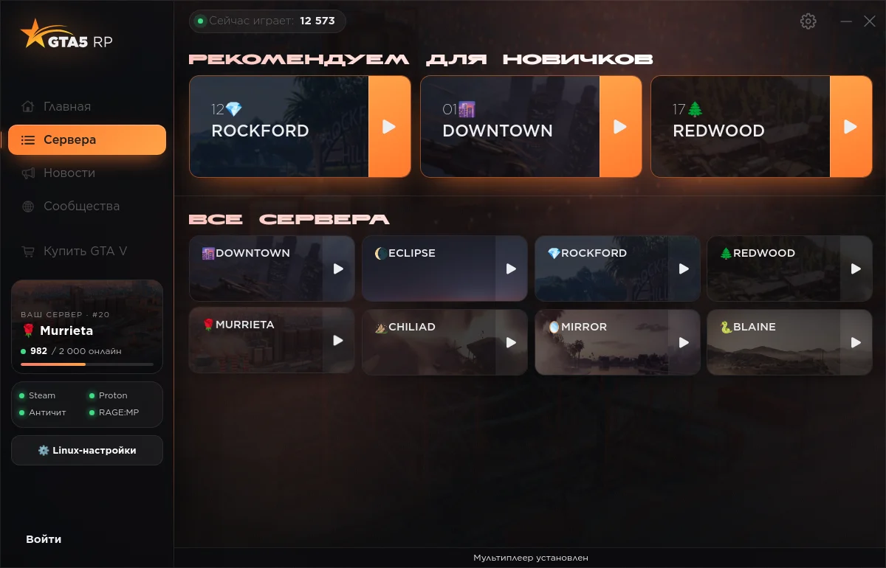
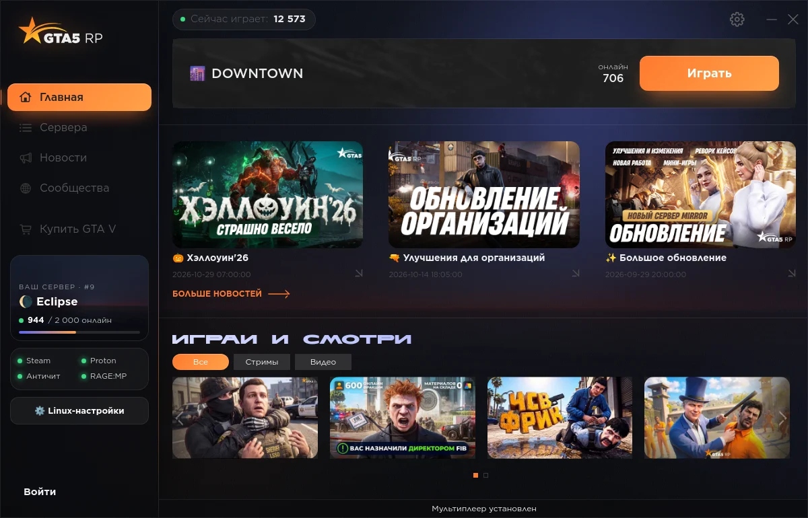
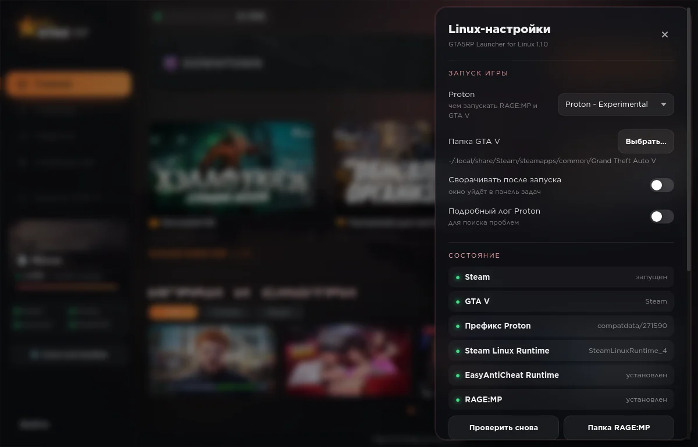
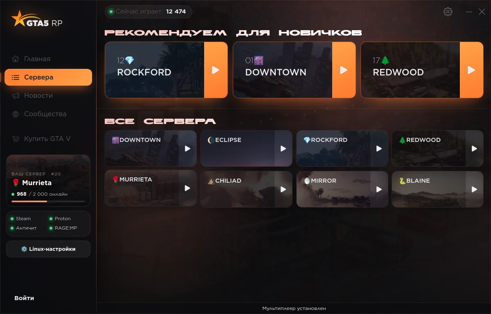
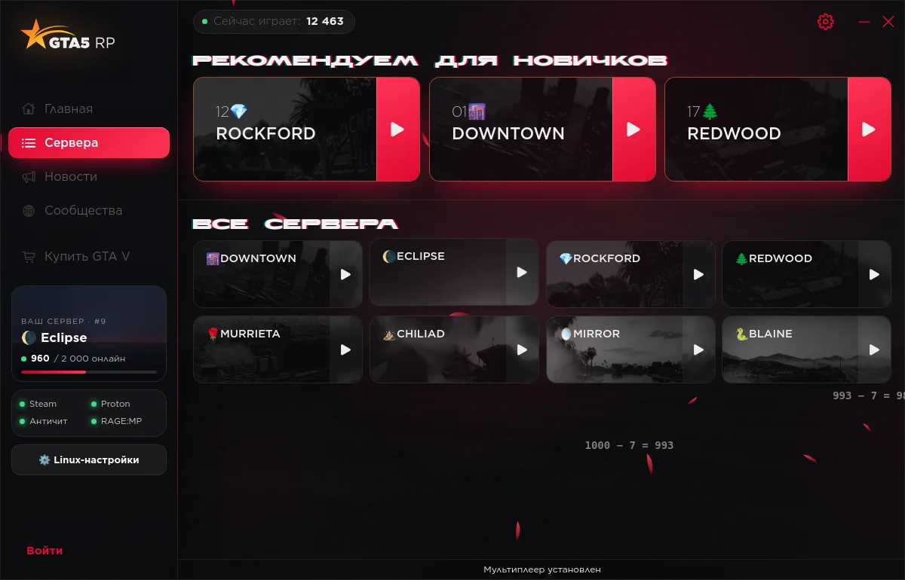
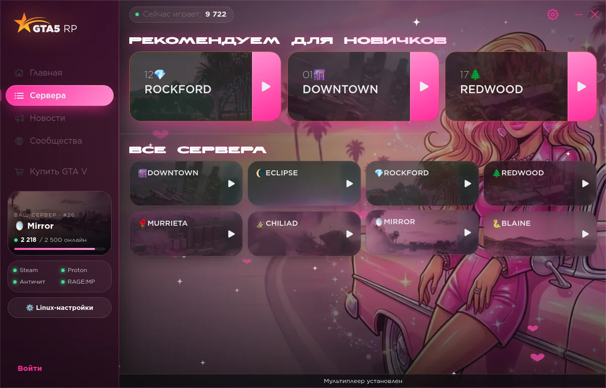
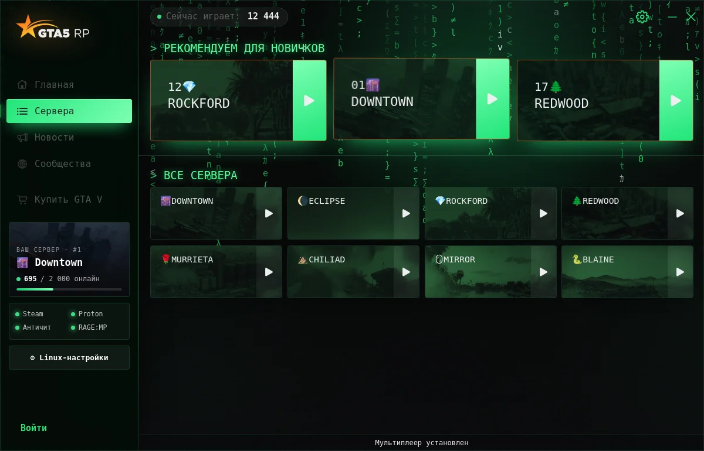
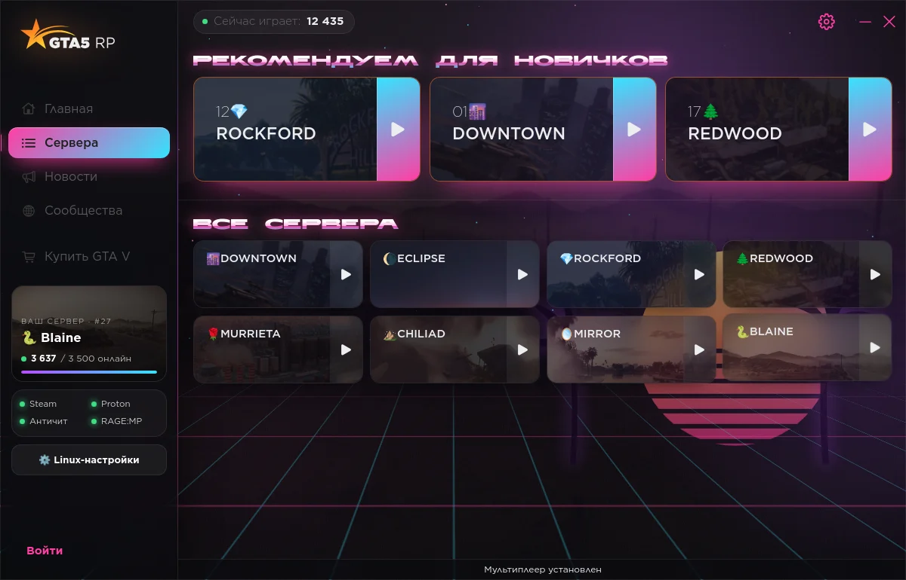
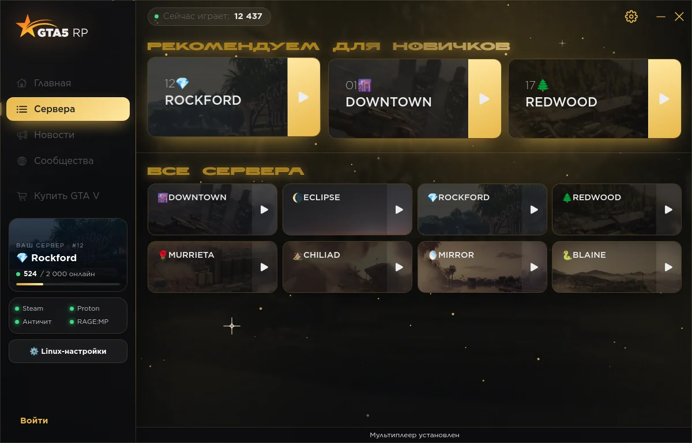
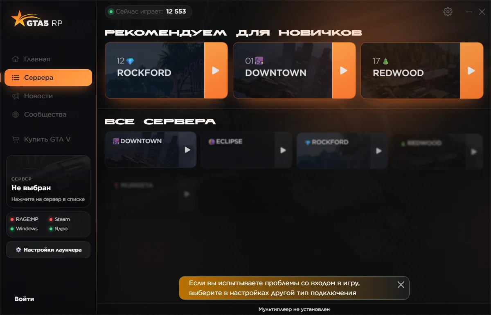

# GTA5RP Launcher for Linux

**Русский** · [English](README.en.md) · [Сайт](https://alinaz18.github.io/gta5rp-launcher-linux/)

Неофициальный лаунчер [GTA5RP](https://gta5rp.com) для **Linux и Windows**. Интерфейс —
оригинальный, из официального установщика 5RP, но с новым оформлением и шестью темами;
вместо защищённого Windows-ядра работает собственное ядро на Python. На Linux RAGE:MP и
GTA V запускаются через Proton или Wine, на Windows — напрямую.

## Поддерживаемые версии GTA V

| Версия | Linux | Как запускается |
|---|---|---|
| **Steam** (Legacy) | ✅ поддерживается | префикс Steam `compatdata/271590`, Proton и Steam Linux Runtime из Steam |
| **Rockstar Games Launcher** (Legacy) | ✅ поддерживается | префикс Heroic, Lutris, Bottles или обычный Wine; Proton (GE-Proton) или Wine этого префикса |
| **Epic Games Store** (Legacy) | 🧪 экспериментально | префикс Heroic; в нём нужен настоящий Epic Games Launcher (лаунчер ставит его кнопкой) |
| **GTA V Enhanced** (любой магазин) | ❌ нет | RAGE:MP работает только с Legacy — поставьте Legacy-версию рядом |

Магазин определяется по файлам в папке игры (`steam_api64.dll` — Steam,
`EOSSDK-Win64-Shipping.dll` — Epic, иначе Rockstar). Выбрать магазин, папку игры,
Wine-префикс и Proton/Wine вручную можно в «Linux-настройках». На Windows подходят все
магазины: RAGE:MP запускает GTA V сам.



| Главная | Linux-настройки |
|---|---|
|  |  |

## Темы

| Оригинальная | zxc · dead inside | Барби |
|---|---|---|
|  |  |  |
| **Вайб-кодер** | **Vice City** | **Diamond Casino** |
|  |  |  |

Каждая тема со своей анимацией: лепестки ликориса, «1000−7» и глитч у zxc, блёстки и
сердечки у Барби, матричный дождь у вайб-кодера, неоновый закат с сеткой и пальмами у
Vice City, золотая пыль у Diamond Casino.

## Возможности

- **Оригинальный интерфейс 5RP** — вход в аккаунт, сервера, новости, профиль, капча и 2FA
  работают как в официальном лаунчере.
- **Живой фон под сервер** — арт выбранного сервера во всё окно, цветные сияния в его
  гамме и свет за курсором; при наведении на другой сервер всё плавно перетекает в его тему.
- **Новое оформление** — стеклянная левая панель, карточки с 3D-наклоном и бликом,
  каскадные анимации; можно облегчить или выключить для слабых ПК.
- **Левая панель** — карточка «Ваш сервер» с живым онлайном и индикаторы магазина / Proton /
  античита / RAGE:MP.
- **Linux-настройки** — версия игры (Steam / Rockstar / Epic), Proton или Wine, папка GTA V
  и Wine-префикс, установка Rockstar / Epic Games Launcher в префикс, сворачивание после запуска, подробный
  лог Proton, проверка системы, установка EasyAntiCheat Runtime, аварийное закрытие игры.
- **Шесть тем с анимацией** — переключаются в настройках одним кликом.
- **Версия для Windows** — тот же интерфейс, фон и темы; RAGE:MP запускается напрямую.
- **Официальный установщик скачивается сам**, если его нет в «Загрузках».
- **Простой интерфейс на Qt** — запасной вариант для Linux (`gta5rp-launcher --classic`).

## Требования

- GTA V **Legacy** из одного из магазинов:
  - **Steam** — с включённым Proton, игру нужно один раз запустить из Steam; Steam должен
    быть запущен во время игры;
  - **Rockstar Games Launcher** — установленная в Wine-префикс (Heroic, Lutris, Bottles или
    свой), с Rockstar Games Launcher в том же префиксе;
  - **Epic Games Store** — обычно через Heroic; в том же префиксе нужен настоящий Epic Games
    Launcher (заглушки Heroic не хватает: Rockstar Launcher проверяет, что его запустил Epic).
    Лаунчер поставит его кнопкой, дальше один раз войдите в Epic и привяжите игру: в Heroic —
    «Синхронизация с Epic Games Launcher» на этот префикс, или в самом Epic «Установить» в папку
    игры (файлы проверятся, а не скачаются заново);
- Proton (из Steam, Heroic, Lutris, ProtonUp-Qt) или Wine;
- **Proton EasyAntiCheat Runtime** — RAGE:MP использует EasyAntiCheat
  (ставится через Steam, лаунчер сам предложит);
- интернет при первом запуске: лаунчер возьмёт официальный установщик из «Загрузок» или
  скачает его с files.gta5rp.com — из него берётся оригинальный интерфейс;
- Python 3.9+, PySide6 с QtWebEngine, Wine (только для распаковки установщика).

## Установка

```sh
git clone https://github.com/alinaz18/gta5rp-launcher-linux
cd gta5rp-launcher-linux
./install.sh
```

Или готовые пакеты из [релизов](https://github.com/alinaz18/gta5rp-launcher-linux/releases):
`.deb` (Debian / Ubuntu / Mint), `.rpm` (Fedora / openSUSE). Для Arch — `packaging/aur/PKGBUILD`.

Первый запуск: лаунчер один раз распакует интерфейс из установщика (~10 секунд).
При первом входе в игру RAGE:MP спросит, можно ли работать из новой папки, — нажмите
**OK**; если он спросит папку GTA V — выберите диск **G:** (это ваша GTA V).

Удаление — `./uninstall.sh`.

### Windows

Скачайте `GTA5RP-Launcher-Setup-*.exe` (или portable-архив) из
[последнего релиза](https://github.com/alinaz18/gta5rp-launcher-linux/releases/latest) и запустите.
Официальный лаунчер 5RP скачается и установится сам — из него берётся интерфейс.


*Снято автотестом на настоящей Windows в GitHub Actions.*

## Как это работает

Официальный лаунчер состоит из интерфейса на Electron и защищённого ядра
`GTA5RPLauncher.exe`, которые общаются JSON-сообщениями. Этот лаунчер:

1. достаёт интерфейс (`app.asar`) из вашего установщика и показывает его в Qt WebEngine;
2. отвечает на сообщения интерфейса своим ядром (`gta5rp_webui.py`);
3. по кнопке «Играть» делает то же, что оригинал: кладёт RAGE:MP `updater.exe` в
   `C:\Games\GTA5RP\RageMP`, пишет адрес сервера и игровой токен в
   `HKCU\Software\RAGE-MP` (`launch2.*`) и запускает updater через Proton в префиксе
   GTA V (у Steam-версии — `compatdata/271590`; у Rockstar и Epic — Wine-префикс, где они
   стоят, через Proton без Steam, как Heroic/umu, или через Wine).

Файлы интерфейса GTA5RP не входят в репозиторий — они берутся только из официального
установщика. Логотип, арты серверов и интерфейс на скриншотах — © GTA5RP. Ежедневный [watchdog](.github/workflows/watchdog.yml) проверяет,
что API 5RP и зеркала RAGE:MP отвечают как ожидается, и открывает issue, если что-то
изменилось.

## Отказ от ответственности

Проект не связан с GTA5RP, RAGE Multiplayer, Rockstar Games или Valve. Используйте на
свой страх и риск; решения о блокировках принимает администрация проекта.

Лицензия — [MIT](LICENSE).
